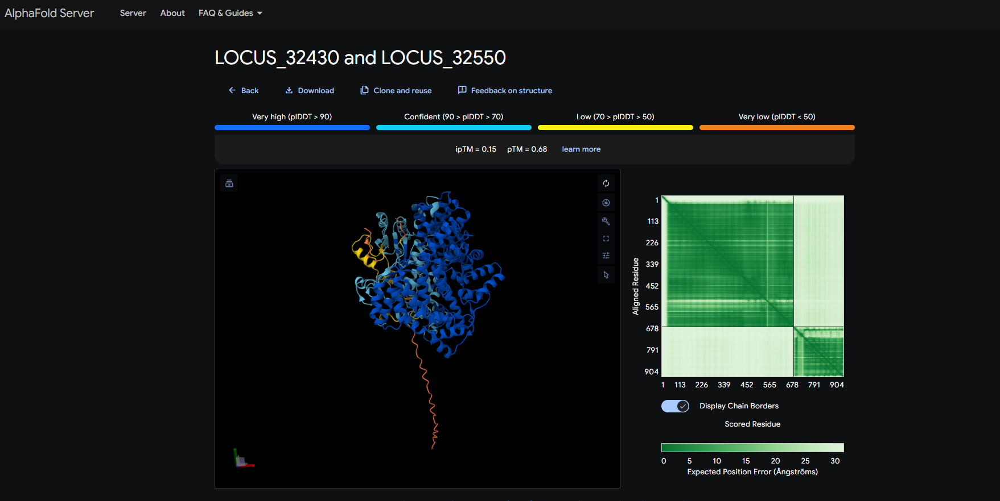
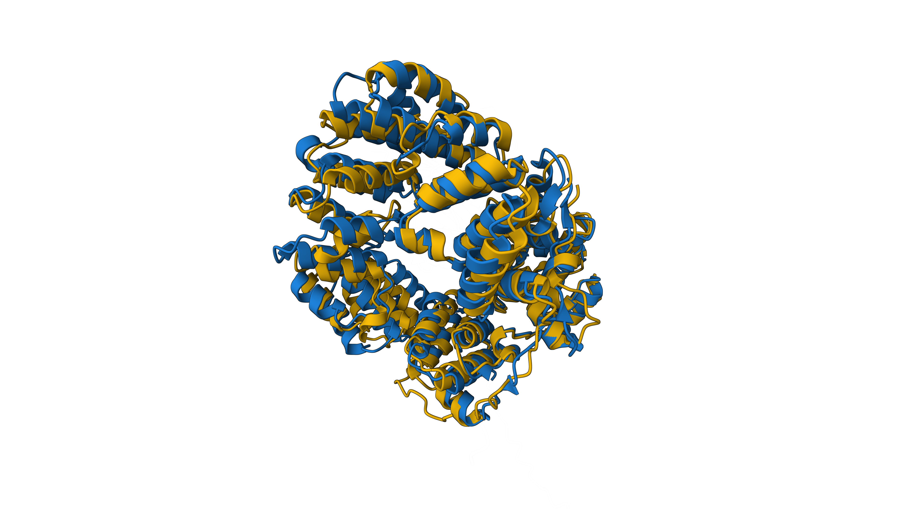

> **Note / Study Log Disclaimer:** This post documents an exploratory, self-directed undergraduate bioinformatics workflow conducted on publicly available sequencing data `SRR41839919`). AI-assisted scripting was utilized to navigate Linux environment constraints and pipeline syntax, while all genomic assembly, annotation, and 3D structural predictions were executed using standard computational tools `Flye`, `DFAST`, `AlphaFold 3`, and `Foldseek`). The findings presented here represent preliminary *in silico* observations for educational and portfolio purposes and have not undergone experimental wet-lab validation.

{: .prompt-info }

1. Project Overview & Objective

Public repositories like NCBI SRA contain vast amounts of raw sequencing data from newly isolated environmental strains that have not yet been assembled or functionally characterized. In this project, I did an end-to-end comparative genomics and structural bioinformatics pipeline on an uncharacterized Oxford Nanopore Technologies (ONT) dataset: *Pseudomonas* sp. NIFoS 1045 `PRJNA1563381` / `SRR41839919`). * 

[www.ncbi.nlm.nih.gov/Traces/?view=run_browser&acc=SRR41839919&display=metadata](https://www.ncbi.nlm.nih.gov/Traces/?view=run_browser&acc=SRR41839919&display=metadata)

**Primary Goal:** Reconstruct a high-contiguity draft genome from raw ONT long reads under constrained local hardware (Windows 11 WSL2 UBUNTU, 8GB RAM), mine integrated prophage regions, and validate novel antimicrobial endolysin candidates via AI-driven 3D structural homology. 

**Key Discovery:** Identified a prophage-associated lytic transglycosylase `LOCUS_32430`) exhibiting **Twilight Zone sequence divergence** `27.3–31.4%` sequence identity) yet **near-identical 3D catalytic fold conservation** `E-value = 3.88e-30`, `Prob = 1.00`) against experimentally resolved X-ray crystal structures.

2. Performance Summary

## 2. Pipeline Architecture & Performance Summary

| Pipeline Stage | Tool / Engine | Key Parameters & Resource Optimization | Output & Verified Metrics |

| :--- | :--- | :--- | :--- |

| **1. Data Retrieval & QC** | `sra-tools` (v3.1+), `seqkit` | `seqkit seq -m 2000 -Q 12` | **19,211 reads**, **326.4 Mb** (~52.6x depth), **N50 = 26,441 bp**, Q20+ = 90.43% |

| **2. De Novo Assembly** | `Flye` (v2.9.6) | `--nano-hq --genome-size 6.2m --threads 2` (WSL2 Swap tuning) | Complete draft assembly, **GC = 61.04%** |

| **3. Genome Annotation** | `DFAST` | Strain-specific bacterial annotation | **7,668 CDS** predicted and functionally labeled |

| **4. Prophage Mining** | `seqkit`, `awk`, `grep` | Locus clustering & domain screening `LOCUS_32260–32600`) | Extracted candidate endolysin *`LOCUS_32430`** and tail protein *`LOCUS_32550`** |

| **5. 3D Structure & Homology** | `AlphaFold 3`, `Foldseek` | Monomer folding & `PDB100` structural alignment | Catalytic core (26–654 aa) modeled at **pLDDT > 90**; matched PDB *`5O1J`** & *`6FC4`** |

---

3. Step-by-Step Troubleshooting Log

3.1 Raw Read Quality Control & Filtering

Analysis of `SRR41839919` revealed high-accuracy R10.4.1 ONT long reads `AvgQual = 18.73`, `Q30 = 83.05%`). Short, low-quality fragments `< 2,000 bp`, `< Q12`) were stripped prior to assembly:

```
bash
fasterq-dump ./SRR41839919.sra --threads 4 --temp /tmp -O .
gzip SRR41839919.fastq
seqkit seq -m 2000 -Q 12 SRR41839919.fastq.gz -o SRR41839919_clean.fastq.gz
```

3.2 Memory-Constrained De Novo Assembly (Flye)

Running Flye in --nano-hq mode on an 8GB RAM WSL2 instance triggered an Out-Of-Memory (OOM) termination during samtools sort (-@ 4 -m 1G) in the consensus polishing stage. I resolved this by allocating a 6GB swap space via .wslconfig, isolating the Conda binary path from broken system packages, and resuming directly from the consensus stage:

```
flye --nano-hq 01_clean_reads/SRR41839919_clean.fastq.gz \

     --out-dir 02_assembly \

     --genome-size 6.2m \

     --threads 2 \

     --resume-from consensus
```

3.3 Prophage Region & Endolysin Candidate Extraction

Scanning the 7,668 annotated proteins from DFAST revealed a distinct prophage gene cluster spanning LOCUS_32260 to LOCUS_32600, anchored by a phage holin (LOCUS_32260) and phage Gp37/Gp68 tail protein (LOCUS_32550). Within this region, LOCUS_32430 was annotated as a lytic transglycosylase domain-containing protein a key peptidoglycan-degrading enzyme class utilized by bacteriophages to lyse host cell walls.

```
# Isolate prophage cluster and extract target endolysin sequence
grep "^>" 03_annotation/protein.faa | awk '/LOCUS_32250/,/LOCUS_32600/'
seqkit grep -p "LOCUS_32430" 03_annotation/protein.faa > 04_prophage/LOCUS_32430.faa
```

4. 3D Structural Validation (AlphaFold 3 & Foldseek)

Because LOCUS_32430 exceeded the 400 aa REST API limit of ESMFold, full-length 3D structure prediction was executed using AlphaFold Server (AlphaFold 3).



Figure 1. AlphaFold 3 predicted 3D structure of LOCUS_32430 (left) and Predicted Aligned Error (PAE) matrix (right). The globular catalytic core (residues 26–654) folds into a high-confidence alpha-helical domain (pLDDT > 90, dark blue), while the N-terminal signal/anchor tail remains flexible.

To verify whether this diverged sequence retains a functional catalytic fold, the predicted .cif model was queried against the PDB100 database using Foldseek:



Figure 2. Foldseek structural homology hits against PDB100, demonstrating 100% probability matches (Prob. = 1.00) to bacterial and phage lytic transglycosylases despite low sequence identity.

5. Future Work

- Perform active-site residue mapping and molecular docking with peptidoglycan fragments (NAG-NAM) using UCSF ChimeraX / AutoDock Vina.
- Screen the remaining hypothetical proteins (LOCUS_32570–32600) in the prophage cluster for tail fiber host-specificity determinants.

---

6. Supplementary Data & Reproducibility

The extracted amino acid sequence and AlphaFold 3 predicted 3D atomic coordinates are available for direct download and visualization (e.g., via UCSF ChimeraX, PyMOL, or Mol*):

- **Target Endolysin Sequence (FASTA):** `LOCUS_32430.faa`](/assets/data/LOCUS_32430.faa)
- **AlphaFold 3 Predicted 3D Structure (mmCIF):** `LOCUS_32430.cif`](/assets/data/LOCUS_32430.cif.cif)

